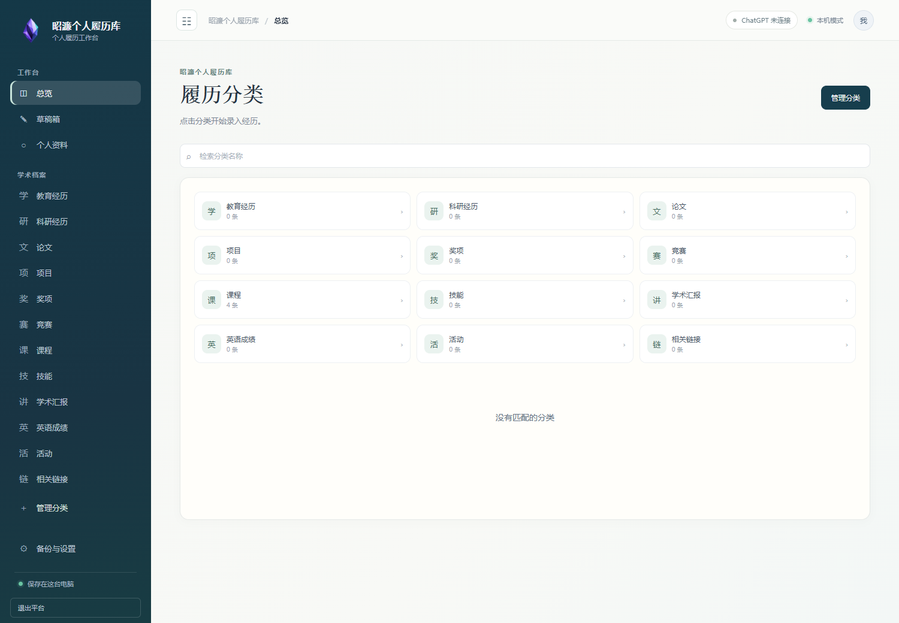
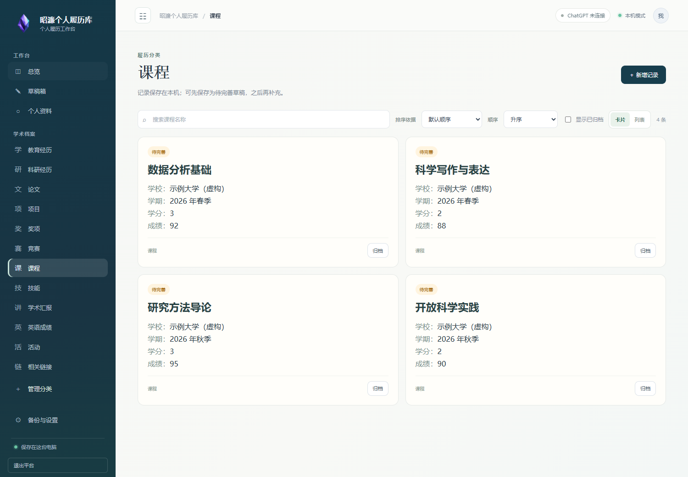

<p align="center"></p>

# 昭濂个人履历库

记录学业、科研和成长路径的私人工作台。

把散落在笔记、成绩单和文档中的经历，整理为自己能够长期维护的履历库。中文界面，在本机浏览器操作；支持自定义分类、附件草稿和 ChatGPT 辅助整理。日常手工录入无需联网。

**[下载 Windows 试用版](https://github.com/Wang-Zhaolian/zhaolian-profile/releases/latest)** · [使用指南](docs/使用指南.md) · [隐私与备份](docs/隐私与备份.md) · [反馈问题](https://github.com/Wang-Zhaolian/zhaolian-profile/issues/new/choose)

## 下载后怎样打开

1. 在下载页面选择 `ZhaolianProfile-0.3.0-windows-x64.zip`，完整解压到一个文件夹。
2. 双击 `ZhaolianProfile-0.3.0.exe`，等待浏览器自动打开。
3. 点击一个分类开始记录，或把文字、图片、文档放入草稿箱。

无需安装 Python。首次启动是一份空白资料库，之后录入的内容保存在 Windows 当前用户的 `%LOCALAPPDATA%\ZhaolianProfile` 中。更新时替换程序文件即可，保留资料目录。退出请使用页面中的退出按钮。

目前提供 Windows x64 试用包；其他系统没有经过桌面版验收。安装包暂未进行代码签名，可用发布页的 SHA256 校验值核对文件来源；无需关闭系统安全防护。

## 可以做什么

- **按自己的方式分类**：初始提供教育、科研、论文、课程等十二类，可自行增加、改名、排序、归档，并编辑每类的字段。
- **先记下，再整理**：草稿箱支持文字和多个附件混合保存；AI 提出的候选由你修改、删除和统一审核，采纳后的记录进入对应分类。
- **资料更容易找**：按卡片标题检索；数字与日期支持升降序；卡片和列表统一展示表单前五项。
- **AI 由你控制**：使用自己的 ChatGPT 账号授权，记住上次模型选择；不会自动切换到其他服务商或付费 API。
- **本机优先**：联系方式、原笔记、附件和凭据保留本机；可手动将履历文字备份到自己的私有 GitHub 仓库。

平台当前专注于经历记录与整理，不提供简历生成或 PDF／Word／LaTeX 简历导出。

## 界面预览

以下截图仅包含虚构示例资料，下载版不会预装这些经历。




## AI 与附件说明

AI 是可选功能，使用者需要自行登录授权。账号资格、地区、权限、可用模型及额度以实际授权和请求结果为准，不保证所有 ChatGPT 订阅账号均可使用。授权不会授予读取既有 ChatGPT 对话的权限。未连接 AI 时仍可手工维护资料。

支持 PNG、JPG、WEBP、PDF、DOCX、TXT、Markdown、XLSX、PPTX。只有主动发起 AI 整理时，选中的内容才会发送用于识读。Office 文档转 PDF 使用本机 Microsoft Word、Excel 或 PowerPoint；没有对应软件或转换失败时，可自行转成 PDF 上传。

## 源码运行

需要 Python 3.11 或更新版本及 [uv](https://docs.astral.sh/uv/)。在克隆后的项目目录运行：

```powershell
uv sync --frozen --extra dev
uv run academic-profile-desktop
```

开发运行也默认使用本机应用数据目录。测试或开发时请显式选择独立资料目录：

```powershell
uv run academic-profile-desktop --home "D:\Zhaolian-Test-Library"
uv run pytest
```

详见[开发与打包](docs/开发与打包.md)。项目源码、个人资料和私人备份仓库分别维护，公开项目不收集使用者的履历。

## 反馈与授权状态

欢迎在 Issues 中反馈使用体验。请勿上传自己的成绩单、电话号码、登录凭据或完整资料目录；说明操作步骤并提供脱敏截图即可。

本项目目前提供公众试用，暂未添加开源许可证；不应理解为已经授予自由修改、再分发或商业使用的通用许可。依赖软件保持各自的许可，见 [第三方说明](THIRD_PARTY_NOTICES.md)。
